# Rádio Definido por Software em FPGA: modulador BASK e 4-ASK

Sistema completo de comunicação digital implementado em uma placa DE10-Lite, da síntese do sinal até a reconstrução no receptor. O projeto gera `m(t)` por DDS, digitaliza o sinal com o ADC MCP3002, modula uma portadora de 100 kHz em BASK ou 4-ASK e recupera o sinal com um receptor híbrido, analógico e digital.

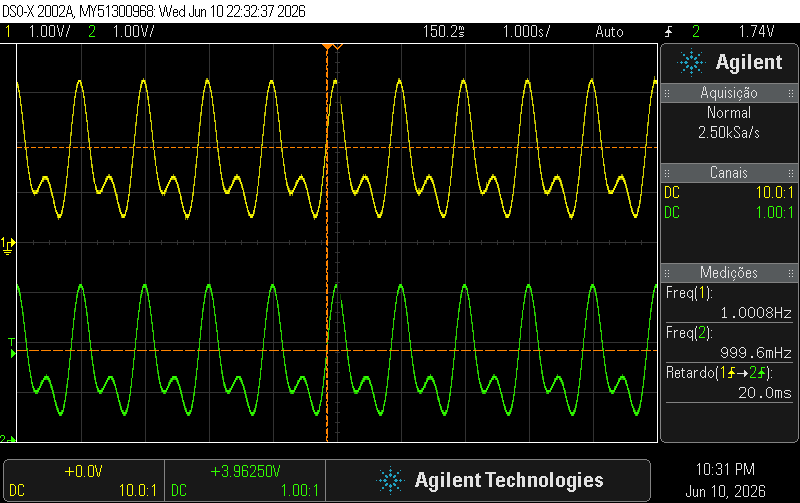

*Sinal de entrada (amarelo) e saída reconstruída pelo receptor BASK (verde): ambos a 1 Hz, com atraso medido de 20 ms.*

**Tecnologias:** Verilog · Intel MAX 10 · Quartus Prime Lite 18.1 · SPI · DDS · PWM · BASK · 4-ASK · filtros analógicos · Python

📄 [Relatório final completo](docs/relatorio-final.pdf)

## Requisitos

O projeto foi desenvolvido individualmente para a disciplina PBLE04 — Projeto de Modulador Configurável em FPGA, na UNIFEI, ministrada pelo Prof. Mateus A. F. C. Junqueira. A proposta pedia para:

- gerar `m(t) = 3cos(2πt) + 2cos(4πt + π/6)` por DDS, com filtro passa-baixa de 1ª ordem;
- digitalizar o sinal com o MCP3002, usando 8 bits por amostra e `fs = 200 Hz`;
- modular em BASK com portadora de 100 kHz, usando PWM e filtro passa-faixa de 2ª ordem;
- demodular com detector de envelope e reconstruir o sinal com PWM e filtro passa-baixa;
- refazer a etapa de transmissão em 4-ASK.

## Arquitetura

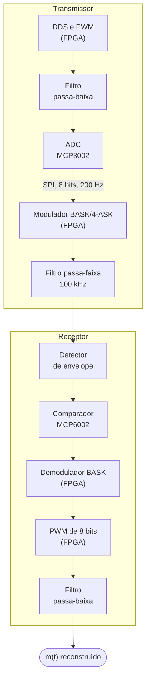

O hardware analógico está detalhado no [esquemático completo](hardware/esquematico-completo.png) e na [lista de componentes](hardware/lista-de-componentes.md).

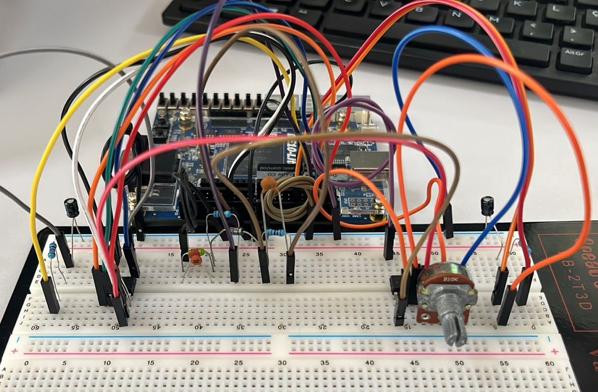

## Etapas e resultados

### 1. Geração do sinal por DDS

Dois acumuladores de fase de 32 bits endereçam uma tabela do cosseno de 1024 posições e 12 bits. As componentes recebem ganhos 3 e 2, são somadas e viram um PWM de 100 kHz. Um filtro RC com corte próximo de 16 Hz reconstrói o sinal analógico.

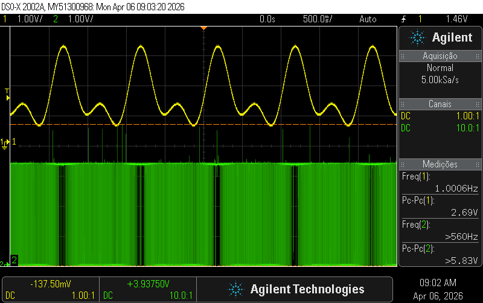

Código: [`rtl/p1-dds-pwm`](rtl/p1-dds-pwm/)

### 2. Conversão analógico-digital

Uma máquina de estados controla o MCP3002 por SPI, com leitura do canal 0 a 200 amostras/s e SCLK de 25 kHz. A FPGA aproveita os 8 bits mais significativos da conversão, totalizando 1600 bit/s.

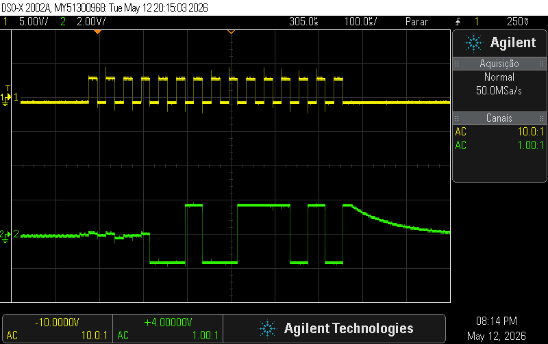

Código: [`rtl/p2-adc-mcp3002`](rtl/p2-adc-mcp3002/)

### 3. Modulação BASK

Cada bit liga ou desliga uma portadora de 100 kHz gerada na FPGA.

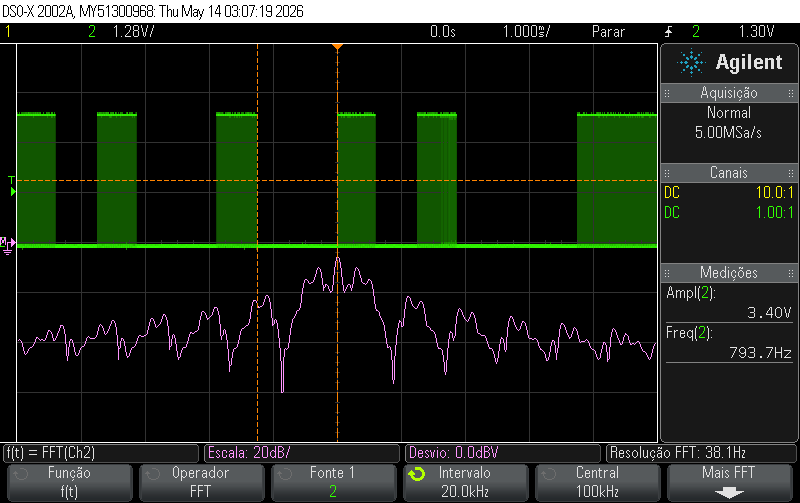

Código: [`rtl/p3-modulador-bask`](rtl/p3-modulador-bask/)

### 4. Filtro passa-faixa

Um filtro RLC paralelo de 2ª ordem seleciona a componente fundamental da portadora. Com L = 1 mH, C = 2,53 nF e R = 4,7 kΩ, a frequência central fica em cerca de 100 kHz e a largura de banda em 13,4 kHz.

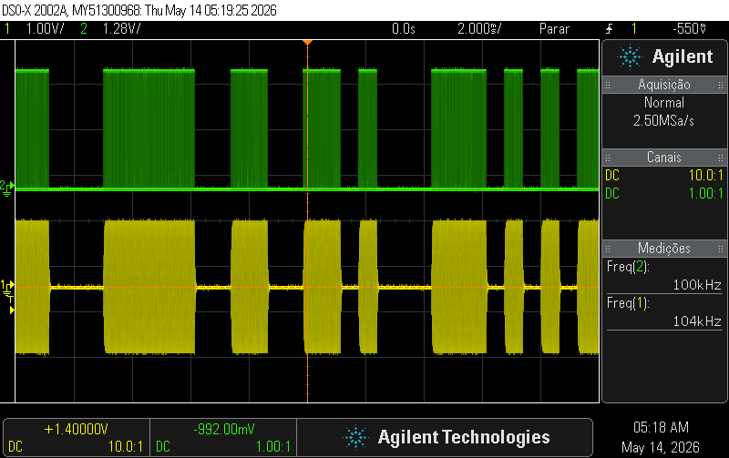

### 5. Detector de envelope

Um diodo Schottky 1N5819 e uma rede RC de 100 µs removem a portadora. A constante de tempo fica entre o período da portadora (10 µs) e o período de bit (625 µs).

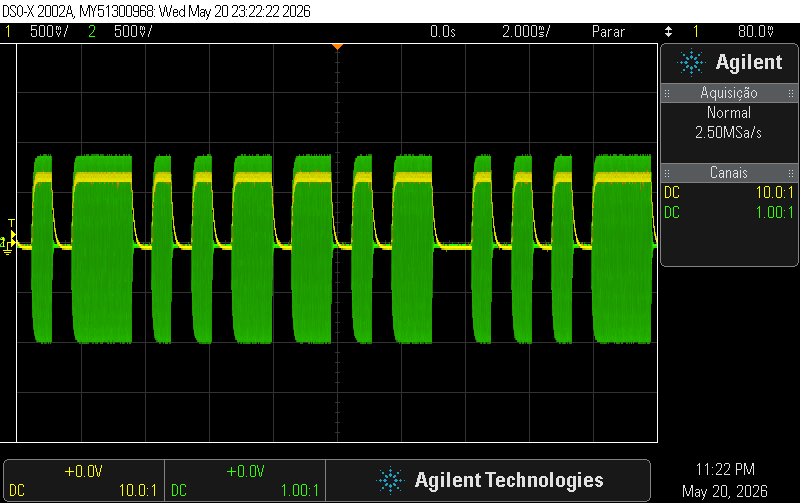

### 6. Receptor e reconstrução

Um comparador com limiar ajustável entrega uma onda quadrada limpa à FPGA. O demodulador recupera o relógio de bit a partir das transições, remonta os bytes e aciona um PWM de aproximadamente 195 kHz. Um filtro RC com corte próximo de 16 Hz reconstrói `m(t)`.

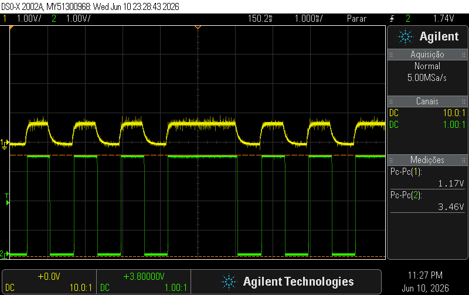

Código: [`rtl/p6-receptor-bask`](rtl/p6-receptor-bask/)

### 7. Evolução para 4-ASK

Cada símbolo passa a carregar 2 bits, reduzindo a taxa de 1600 para 800 baud sem alterar a taxa de 1600 bit/s. O nível de amplitude vem do ciclo útil `D` do PWM, porque a componente fundamental é proporcional a `sin(πD)`.

| Símbolo | Ciclo útil teórico | Ciclo útil calibrado |
|---|---|---|
| `00` | 0% | 0% |
| `01` | 11% | 7% |
| `10` | 23% | 19% |
| `11` | 50% | 50% |

Os valores teóricos não produziram níveis uniformes na saída do filtro. Por isso, os ciclos úteis foram calibrados experimentalmente com o osciloscópio.

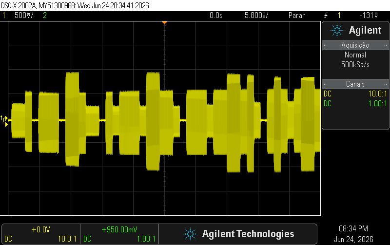

A FFT do osciloscópio mostrou o ganho de eficiência espectral: os primeiros nulos passaram de `fc ± 1600 Hz` no BASK para `fc ± 800 Hz` no 4-ASK.

| BASK | 4-ASK |
|---|---|
| 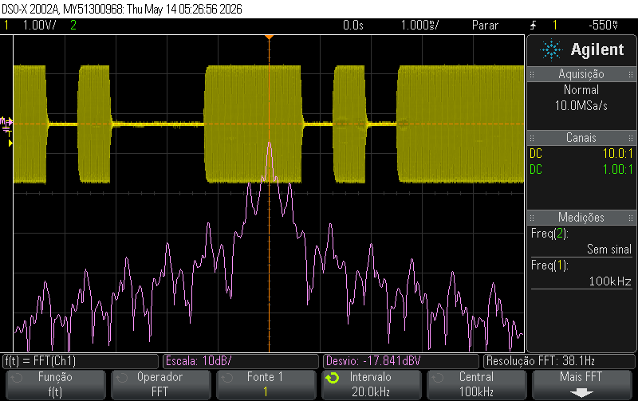 | 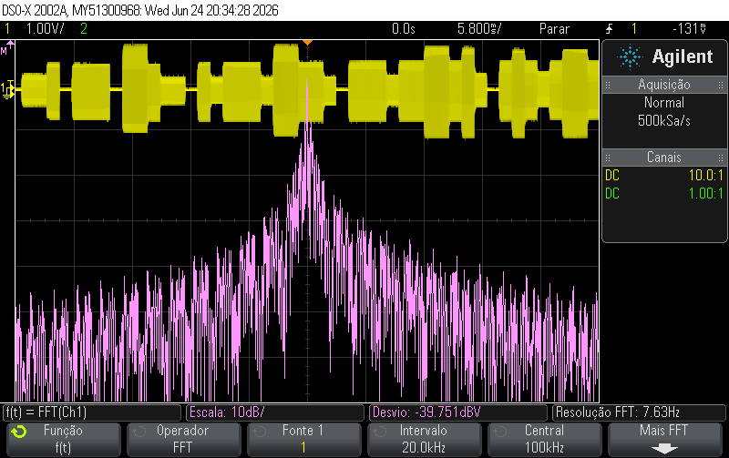 |

Código: [`rtl/p7-modulador-4ask`](rtl/p7-modulador-4ask/)

## Como reproduzir

1. Monte o circuito do [esquemático](hardware/esquematico-completo.png).
2. Abra `quartus/PWM_MCP.qpf` no Quartus Prime Lite 18.1.
3. Em [`rtl/top/PWM_MCP.v`](rtl/top/PWM_MCP.v), escolha a configuração. A versão atual ativa o modulador 4-ASK. Para testar a cadeia BASK completa, ative `bask_modulator` e `top_receptor_final` e desative `ask4_modulador`.
4. Compile e grave na DE10-Lite.

A pinagem usada está em `quartus/PWM_MCP.qsf`:

| Sinal | Direção | Pino | Função |
|---|---|---|---|
| `clk` | Entrada | `PIN_P11` | Relógio de 50 MHz |
| `rst` | Entrada | `PIN_B8` | Reset ativo em nível baixo |
| `ADC_CS` | Saída | `PIN_V10` | Seleção do MCP3002 |
| `ADC_SCLK` | Saída | `PIN_W10` | Relógio SPI |
| `ADC_DIN` | Saída | `PIN_V9` | Comando para o MCP3002 |
| `ADC_DOUT` | Entrada | `PIN_W9` | Dados do MCP3002 |
| `pwm_out` | Saída | `PIN_V8` | Sinal gerado por DDS |
| `pwm_bask_out` | Saída | `PIN_W8` | Sinal modulado |
| `pwm_bask_demodulacao` | Saída | `PIN_W6` | Sinal demodulado |
| `detector_ampOp` | Entrada | `PIN_V5` | Saída do comparador |

## Estrutura do repositório

```text
├── docs/       # Relatório final e figuras
├── hardware/   # Esquemático e lista de componentes
├── quartus/    # Projeto e pinagem
├── rtl/        # Módulos Verilog, separados por etapa
└── scripts/    # Geração da tabela do cosseno e gráfico de m(t)
```

Para gerar a tabela novamente, execute [`scripts/generate_mif.ipynb`](scripts/generate_mif.ipynb) e copie `cos_lut.mif` para `rtl/p1-dds-pwm/`.

## Melhorias futuras

- Adicionar sincronismo de quadro para o receptor funcionar sem compartilhar o reset com o transmissor.
- Selecionar BASK ou 4-ASK por uma chave da placa, sem alterar o código.
- Implementar um demodulador 4-ASK.
- Adicionar testbenches automatizados.

## Autor

**Thiago de Oliveira Sousa Júnior** — Engenharia de Computação, UNIFEI
