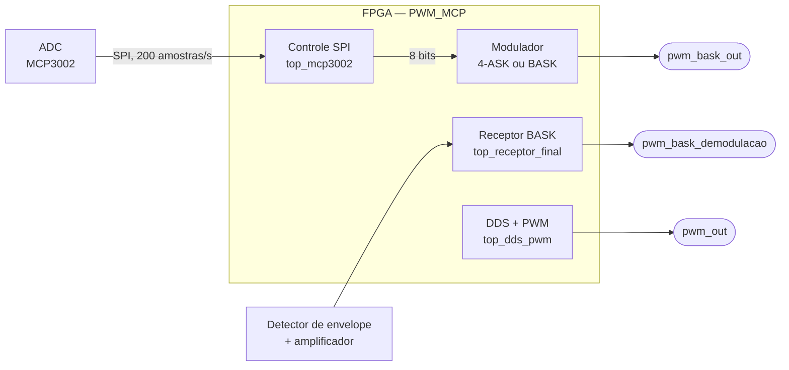

# Modulador Digital Configurável em FPGA

Cadeia de comunicação digital descrita em Verilog para a disciplina PBLE04: gera sinais por DDS, digitaliza uma entrada analógica com o ADC MCP3002 e transmite as amostras em BASK ou 4-ASK usando uma portadora PWM de 100 kHz. O repositório também inclui um receptor BASK digital com saída por PWM.

**Tecnologias:** Verilog · Intel MAX 10 · Quartus Prime Lite 18.1 · SPI · DDS · PWM · ASK · Python

## Arquitetura



> Na configuração atual de [`PWM_MCP.v`](rtl/top/PWM_MCP.v), o modulador 4-ASK fica ativo. O modulador BASK e o receptor estão comentados, então a seleção é feita alterando o código antes de compilar.

## Blocos

| Etapa | Pasta | Função | Parâmetros principais |
|---|---|---|---|
| P1 | [`rtl/p1-dds-pwm`](rtl/p1-dds-pwm/) | Soma dois cossenos gerados por DDS e entrega o resultado em PWM | Fase de 32 bits; tabela de 1024 × 12 bits; PWM de 100 kHz; tons de 1 Hz e 2 Hz, com ganhos 3 e 2 e defasagem de 30° |
| P2 | [`rtl/p2-adc-mcp3002`](rtl/p2-adc-mcp3002/) | Controla o MCP3002 por SPI e entrega amostras de 8 bits | Canal 0; 200 amostras/s; SCLK de 25 kHz; descarta os 2 bits menos significativos |
| P3 | [`rtl/p3-modulador-bask`](rtl/p3-modulador-bask/) | Transmite cada amostra bit a bit em BASK/OOK | 1600 bit/s; portadora de 100 kHz com 50% de ciclo útil |
| P6 | [`rtl/p6-receptor-bask`](rtl/p6-receptor-bask/) | Recupera o relógio de bit, remonta o byte e reconstrói o sinal em PWM | Sincronizador de entrada; amostragem no meio do bit; PWM de 8 bits (≈195 kHz) |
| P7 | [`rtl/p7-modulador-4ask`](rtl/p7-modulador-4ask/) | Transmite dois bits por símbolo em quatro níveis de ciclo útil | 800 baud (1600 bit/s); ciclos úteis de 0%, 7%, 19% e 50% |

O módulo [`pwm_generator`](rtl/p1-dds-pwm/pwm_generator.v) é compartilhado entre P1 e P6. A tabela do cosseno é gerada pelo notebook [`generate_mif.ipynb`](rtl/p1-dds-pwm/generate_mif.ipynb).

## Interface do módulo principal

| Sinal | Direção | Descrição |
|---|---|---|
| `clk` | Entrada | Relógio de 50 MHz |
| `rst` | Entrada | Reset ativo em nível baixo |
| `ADC_CS`, `ADC_SCLK`, `ADC_DIN` | Saída | Controle SPI do MCP3002 |
| `ADC_DOUT` | Entrada | Dados do MCP3002 |
| `detector_ampOp` | Entrada | Envelope amplificado, usado pelo receptor |
| `pwm_out` | Saída | Sinal gerado por DDS |
| `pwm_bask_out` | Saída | Sinal modulado |
| `pwm_bask_demodulacao` | Saída | Sinal demodulado, para o filtro passa-baixas |

## Como compilar

1. Crie um projeto no Quartus Prime para a família MAX 10.
2. Adicione todos os arquivos `.v` da pasta `rtl/` e o arquivo `rtl/p1-dds-pwm/cos_lut.mif`.
3. Defina `PWM_MCP` como módulo principal.
4. Escolha o modulador em `rtl/top/PWM_MCP.v`, deixando apenas um deles ativo.
5. Atribua os pinos da sua placa e compile.

## Estrutura

```text
rtl/
├── top/                 # Integração do sistema (PWM_MCP)
├── p1-dds-pwm/          # Gerador DDS e PWM
├── p2-adc-mcp3002/      # Interface com o ADC
├── p3-modulador-bask/   # Modulador BASK
├── p6-receptor-bask/    # Receptor BASK
└── p7-modulador-4ask/   # Modulador 4-ASK
```
